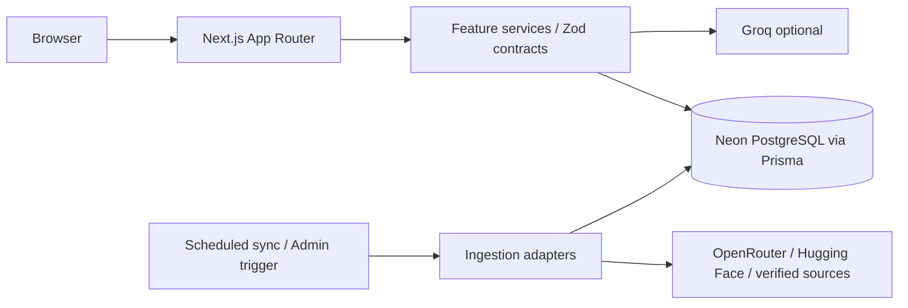

# 02 — Technical Requirements Document (TRD)

## 1. Architecture
A **modular Next.js App Router monolith** deployed to Vercel. Server components read from Prisma services; client components handle interactive search/compare controls; route handlers validate external requests. Neon PostgreSQL stores normalized catalog, benchmarks, provider offerings, ingestion state and optional user data. Groq is an optional enhancement, never a dependency for core discovery.



## 2. Suggested directory layout
```
src/
  app/(public)/{models,compare,rankings,labs,providers}/
  app/(workspace)/workspace/
  app/admin/
  app/api/{models,compare,rankings,labs,providers,advisor,admin,ingestion}/
  features/{catalog,comparison,benchmarks,ecosystem,advisor,workspace,admin}/
    components/ services/ schemas/ tests/
  components/ui/
  lib/{db,auth,rate-limit,errors,config,observability}/
  ingestion/{adapters,normalize,run}/
prisma/{schema.prisma,migrations,seed.ts}
tests/{e2e,fixtures,integration}/
.github/workflows/ci.yml
```
Routes shown are logical; adapt actual route groups to avoid path collisions.

## 3. Data access and search
- Server-side paginated queries; bounded `limit` default 20, max 100; stable secondary sort by ID.
- PostgreSQL full-text search with maintained `tsvector`/GIN index and optional `pg_trgm` for typo tolerance; Prisma raw SQL only via parameterized tagged templates where ORM lacks support.
- Indexed structured filters: lab, modality, open weights/license, context length, provider, capabilities, lifecycle; optional price filters operate on offerings, not model base record.
- Groq may convert natural-language search to a strictly validated filter DTO; no generated SQL or arbitrary field names.
- Compare selected 2–4 distinct models; server validates IDs and rejects invalid/duplicate or excessive inputs.

## 4. Data ingestion
- Adapter interface: `fetchPage(cursor) -> source records`, `normalize`, `validate`, `upsert`, `log`.
- Begin with a small verified seed. Expand toward 200–500 entries only when sources and mappings support them.
- Separate model family, version, provider offering, benchmark definition, and observed result.
- Incremental ingestion by stable external IDs and source timestamps/ETags when supported; idempotent upserts and per-source run logs.
- Stage/validate before committing; failures must not truncate existing validated catalog. Never mark inferred values as verified.
- Schedule using supported Vercel Cron cadence, or GitHub Actions as fallback; respect provider rate limits and hosting plan restrictions.

## 5. Caching and freshness
- Public catalog and detail reads may use Next.js caching/revalidation; user-specific or admin responses must be dynamic and private.
- Invalidate relevant tags/paths only after successful ingestion; show `observedAt` and source freshness independently of cache age.
- Debounce client search input (~250–350 ms); lazy-load expensive charts; avoid blocking initial rendering on Groq.
- No Redis unless profiling establishes need.

## 6. Cost calculations
- Persist provider-specific input/output price **per million tokens** with currency and observedAt, when sourced.
- `cost = inputTokens / 1_000_000 * inputPrice + outputTokens / 1_000_000 * outputPrice` for compatible units/currency.
- Compute with decimal-safe arithmetic (Prisma Decimal/decimal library or integer micros), not unguarded floating-point for stored money. Present estimate with caveats for cache hits, batch pricing, tiering, and provider policies.
- If either price missing, cost is `unknown`, never zero. User inputs bounded and nonnegative.

## 7. Rankings
- Benchmark definitions specify category, unit, score direction (higher/lower better), evaluation method and source.
- Rank only scores from comparable benchmark definition/version and methodology. Missing/old results shown separately.
- Do not average arbitrary benchmark percentages. Optional composite only if normalization, coverage and weighting are documented and reviewed.

## 8. Nonfunctional targets (engineering goals, not measured claims)
- Core public pages accessible without Groq, OAuth or ingestion jobs running.
- Target Core Web Vitals in field/lab tests: LCP <=2.5s, INP <=200ms, CLS <=0.1 at p75 where measurable; do not claim achieved without measurement.
- Target p95 indexed catalog API latency <500 ms for seed-scale queries in production-like conditions, subject to cold starts/network.
- Accessible focus states, keyboard navigation, semantic headings, labeled controls, reduced-motion support, accessible chart summaries.
- Sensitive secrets never sent to client bundles; bounded external calls with timeouts and controlled retry policy.

## 9. Operational boundaries
- Development/production Neon isolation; preview deployment must never run production migrations.
- GitHub Actions: install, lint, typecheck, unit/contract tests, build; opt-in live smoke only.
- Vercel deploy via integration. No separate backend service or persistent background worker.
- Document decisions and deviations in PRs; Codex must not make architectural pivots silently.

## 10. Feature acceptance gate
For each feature: DTO validation, server-side data access, responsive UI, loading/empty/error states, source display where relevant, unit/integration tests, and one manual smoke scenario. Feature flags hide incomplete P1/P2 features.
